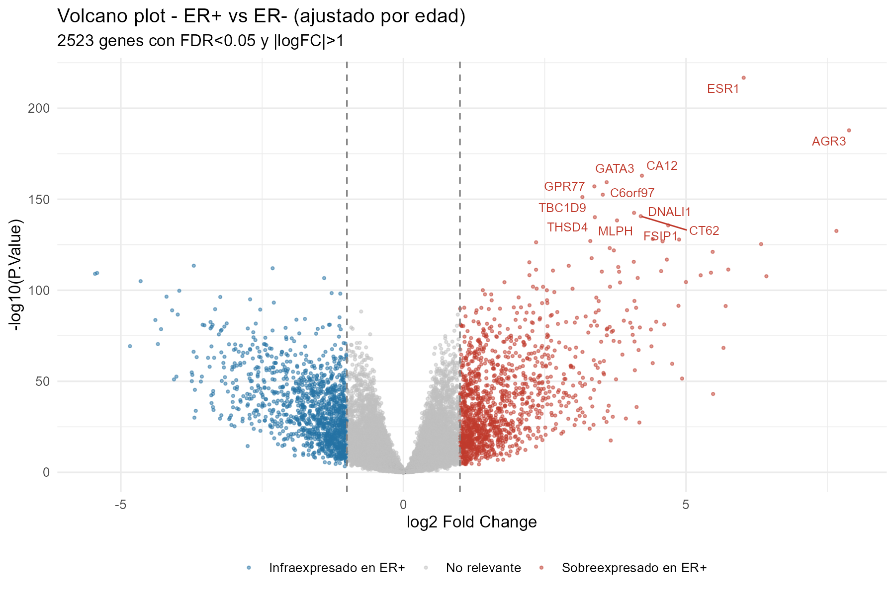
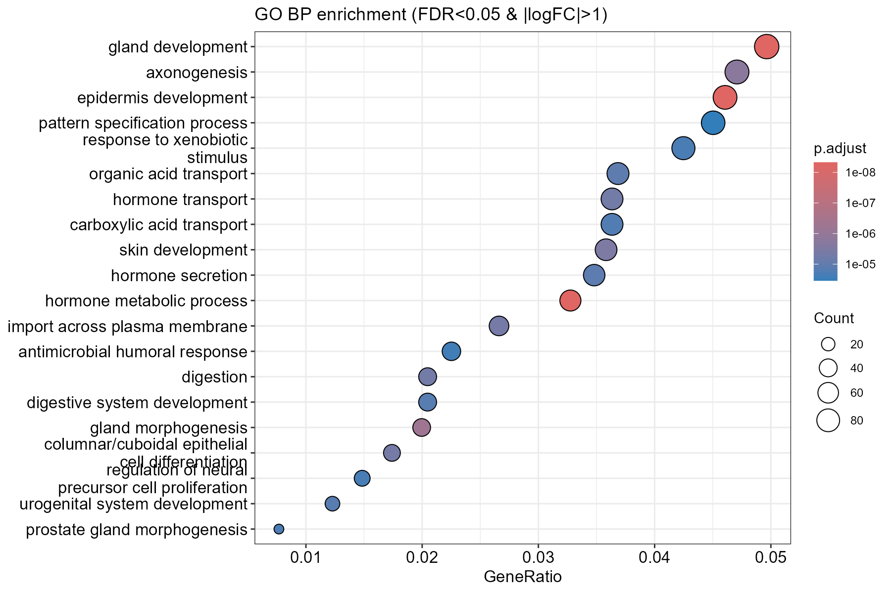

# Expresión diferencial y activación de rutas en TCGA-BRCA

*[English version](README.md)*

Dos análisis independientes en R sobre datos de RNA-seq de cáncer de mama, ambos comparando tumores con receptor de estrógenos positivo frente a negativo. El primero trabaja a nivel de gen y el segundo a nivel de ruta de señalización.

El trabajo surgió como práctica del Máster Universitario en Bioinformática (Universidad Europea) y se ha revisado y reorganizado para este repositorio.

## Qué hace

**`01_differential_expression_go.R`**

Expresión diferencial con limma ajustando por edad al diagnóstico, seguida de enriquecimiento GO de procesos biológicos con clusterProfiler. Los counts se normalizan con TMM y se transforman a logCPM (edgeR); el diseño es `~ estrogen_receptor + age_years` con ER negativo como nivel de referencia.

**`02_hipathia_pathway_activation.R`**

La misma comparación desde otro ángulo. En lugar de contrastar genes uno a uno, hipathia propaga la señal de expresión a través de rutas KEGG representadas como grafos dirigidos y calcula un valor de activación para cada circuito de señalización. La activación diferencial se contrasta después con limma sobre la matriz de circuitos, lo que responde a qué partes de qué rutas están diferencialmente activas en vez de a qué genes están diferencialmente expresados.

Los dos scripts son independientes y pueden ejecutarse en cualquier orden.

## Datos

No se incluyen en el repositorio. Son datos clínicos y de expresión de la cohorte TCGA-BRCA, y aunque son de acceso abierto, se citan en lugar de redistribuirse.

Ambos scripts esperan dos archivos en `data/`:

- `BRCA_exp_matrix.tsv`: matriz de counts, genes en filas (símbolo HGNC) y muestras en columnas.
- `clinical_info_TCGA-BRCA.tsv`: tabla clínica con una columna `sample` de identificadores de muestra y las variables `er_status_by_ihc` y `age_at_diagnosis`.

Se pueden pasar otras rutas como argumentos:

```
Rscript 01_differential_expression_go.R ruta/expresion.tsv ruta/clinico.tsv [carpeta_salida]
Rscript 02_hipathia_pathway_activation.R ruta/counts.tsv ruta/clinico.tsv [carpeta_salida]
```

El archivo clínico trae una primera columna sin nombre, así que su cabecera tiene un campo menos que las filas de datos. Los dos scripts lo leen con `read.delim`, que detecta ese caso y realinea la cabecera. Leerlo con `fread` desplaza los nombres de columna y selecciona variables equivocadas de forma silenciosa.

## Resultados

**Expresión diferencial (script 01)**

Tras descartar muestras sin estado ER conocido o sin edad registrada quedan 983 tumores: 759 ER positivos y 224 ER negativos, sobre 20.500 genes.

| | |
|---|---|
| Significativos con FDR < 0,05 | 15.037 (7.403 al alza, 7.634 a la baja en ER+) |
| Que además superan abs(logFC) > 1 | 2.523 |
| Términos GO BP enriquecidos | 462 |



El gen más significativo de los 20.500 es ESR1, que codifica el propio receptor de estrógenos, seguido de GATA3, CA12, AGR3, TBC1D9 y THSD4. Dado que la expresión de ESR1 es lo que en última instancia refleja la clasificación por estado ER, recuperarlo en primera posición funciona como control positivo: el pipeline está captando la biología que define la comparación y no ruido.

El enriquecimiento se ejecutó sobre los 2.523 genes del filtro estricto y devuelve procesos coherentes con esa lectura, encabezados por desarrollo glandular, metabolismo hormonal y transporte y secreción de hormonas.



**Activación de rutas (script 02)**

Pendiente de completar con los resultados de `02_hipathia_pathway_activation.R`.

## Estructura

```
.
├── 01_differential_expression_go.R
├── 02_hipathia_pathway_activation.R
├── figures/                # figuras seleccionadas para este README
├── data/                   # datos de entrada (no versionados)
└── output/                 # resultados generados (no versionados)
```

## Notas metodológicas

Quince mil genes significativos son el 73% del transcriptoma, y esa cifra no debe leerse como un hallazgo. Con 983 muestras y un contraste biológico tan marcado como el estado ER, la potencia estadística es tan alta que el FDR por sí solo deja de discriminar: casi cualquier diferencia real, por pequeña que sea, resulta significativa. Por eso el paso de enriquecimiento aplica el filtro más estricto de abs(logFC) > 1, que reduce el conjunto a 2.523 genes con un tamaño de efecto interpretable. Presentar la cifra de 15.037 sin esa matización sería engañoso.

Alrededor del 14% de los símbolos de gen no mapean a identificadores Entrez al convertirlos para el enriquecimiento. Es esperable en una matriz anotada hace algunos años, porque los símbolos se renombran o se retiran, pero implica que el enriquecimiento se ejecuta sobre un conjunto ligeramente reducido.

El ajuste por edad es una covariable en el modelo lineal, no un diseño emparejado. Corrige el efecto lineal de la edad sobre la expresión y nada más.

## Requisitos

R 4.5.2. Los scripts instalan las dependencias que falten al ejecutarse.

CRAN: `ggplot2`, `dplyr`, `tibble`, `ggrepel`, `pheatmap`, `RColorBrewer`.

Bioconductor: `edgeR`, `limma`, `clusterProfiler`, `org.Hs.eg.db`, `AnnotationDbi`, `hipathia`.

## Licencia

MIT. Ver [LICENSE](LICENSE). La licencia cubre el código de este repositorio. No cubre los datos de TCGA-BRCA, que no se incluyen, ni las definiciones de rutas KEGG que se usan a través de `hipathia`.

## Referencias

Hidalgo MR et al. High throughput estimation of functional cell activities reveals disease mechanisms and predicts relevant clinical outcomes. Oncotarget, 2017.

Ritchie ME et al. limma powers differential expression analyses for RNA-sequencing and microarray studies. Nucleic Acids Research, 2015.

The Cancer Genome Atlas Network. Comprehensive molecular portraits of human breast tumours. Nature, 2012.

## Autor

José Carlos León Miguel
