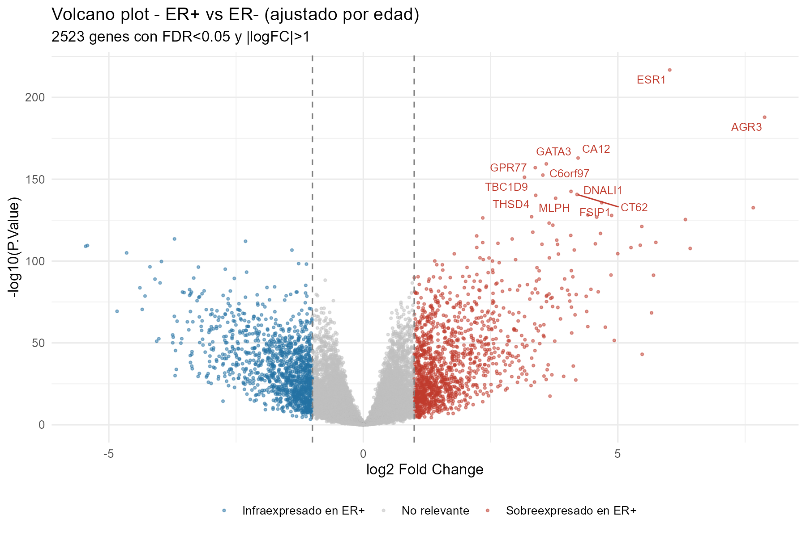
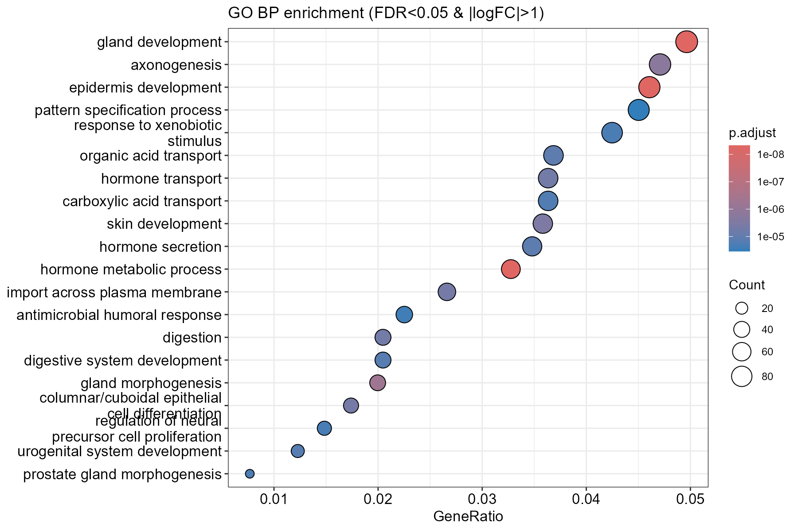

# Differential expression and pathway activation in TCGA-BRCA

*[Versión en español](README.es.md)*

Two independent R analyses on breast cancer RNA-seq data, both comparing oestrogen receptor positive against oestrogen receptor negative tumours. The first works at gene level, the second at signalling pathway level.

The work started as coursework for the MSc in Bioinformatics (Universidad Europea) and has been reviewed and reorganised for this repository.

## What it does

**`01_differential_expression_go.R`**

Differential expression with limma, adjusting for age at diagnosis, followed by GO Biological Process enrichment with clusterProfiler. Counts are normalised with TMM and transformed to logCPM (edgeR); the design is `~ estrogen_receptor + age_years` with ER negative as the reference level.

**`02_hipathia_pathway_activation.R`**

The same comparison from a different angle. Instead of testing genes one by one, hipathia propagates the expression signal through KEGG pathways represented as directed graphs and computes an activation value for each signalling circuit. Differential activation is then tested with limma on the circuit matrix, which asks which parts of which pathways are differentially active rather than which genes are differentially expressed.

The two scripts are independent and can be run in either order.

## Data

Not included in this repository. The input is clinical and expression data from the TCGA-BRCA cohort, and although it is open access, it is cited rather than redistributed here.

Both s expect two files in `data/`:

- `BRCA_exp_matrix.tsv`: count matrix, genes in rows (HGNC symbols) and samples in columns.
- `clinical_info_TCGA-BRCA.tsv`: clinical table with a `sample` column of sample identifiers plus `er_status_by_ihc` and `age_at_diagnosis`.

Alternative paths can be passed as arguments:

```
R 01_differential_expression_go.R path/expression.tsv path/clinical.tsv [output_dir]
R 02_hipathia_pathway_activation.R path/counts.tsv path/clinical.tsv [output_dir]
```

The clinical file carries an unnamed first column, so its header has one field fewer than its data rows. Both s read it with `read.delim`, which detects that case and realigns the header. Reading it with `fread` instead shifts the column names and silently selects the wrong variables.

## Results

**Differential expression ( 01)**

After discarding samples with unknown ER status or missing age, 983 tumours remain: 759 ER positive and 224 ER negative, across 20,500 genes.

| | |
|---|---|
| Significant at FDR < 0.05 | 15,037 (7,403 up, 7,634 down in ER+) |
| Also passing abs(logFC) > 1 | 2,523 |
| Enriched GO BP terms | 462 |



The most significant gene out of 20,500 is ESR1, which codes for the oestrogen receptor itself, followed by GATA3, CA12, AGR3, TBC1D9 and THSD4. Since ESR1 expression is what the ER status classification ultimately reflects, recovering it at the top acts as a positive control: the pipeline is picking up the biology that defines the comparison rather than noise.

Enrichment was run on the 2,523 strict genes and returns processes consistent with that reading, headed by gland development, hormone metabolic process and hormone transport and secretion.




## Repository layout

```
.
├── 01_differential_expression_go.R
├── 02_hipathia_pathway_activation.R
├── figures/                # figures selected for this README
├── data/                   # input data (not versioned)
└── output/                 # generated results (not versioned)
```

## Methodological notes

Fifteen thousand significant genes is 73% of the transcriptome, and that number should not be read as a finding. With 983 samples and a biological contrast as strong as ER status, statistical power is high enough that FDR alone stops discriminating: almost any real difference, however small, becomes significant. This is why the enrichment step uses the stricter abs(logFC) > 1 filter, which brings the set down to 2,523 genes with an effect size worth interpreting. Reporting the 15,037 figure without that qualification would be misleading.

Around 14% of the gene symbols fail to map to Entrez identifiers when converting for enrichment. That is expected for a matrix annotated some years ago, since symbols get renamed or retired, but it means the enrichment runs on a slightly reduced gene set.

The age adjustment is a covariate in the linear model, not a matched design. It corrects for the linear effect of age on expression and nothing more.

## Requirements

R 4.5.2. The scripts install any missing dependency on first run.

CRAN: `ggplot2`, `dplyr`, `tibble`, `ggrepel`, `pheatmap`, `RColorBrewer`.

Bioconductor: `edgeR`, `limma`, `clusterProfiler`, `org.Hs.eg.db`, `AnnotationDbi`, `hipathia`.

## License

MIT. See [LICENSE](LICENSE). The licence covers the code in this repository. It does not cover the TCGA-BRCA data, which is not included here, nor the KEGG pathway definitions used through `hipathia`.

## References

Hidalgo MR et al. High throughput estimation of functional cell activities reveals disease mechanisms and predicts relevant clinical outcomes. Oncotarget, 2017.

Ritchie ME et al. limma powers differential expression analyses for RNA-sequencing and microarray studies. Nucleic Acids Research, 2015.

The Cancer Genome Atlas Network. Comprehensive molecular portraits of human breast tumours. Nature, 2012.

## Author

José Carlos León Miguel
